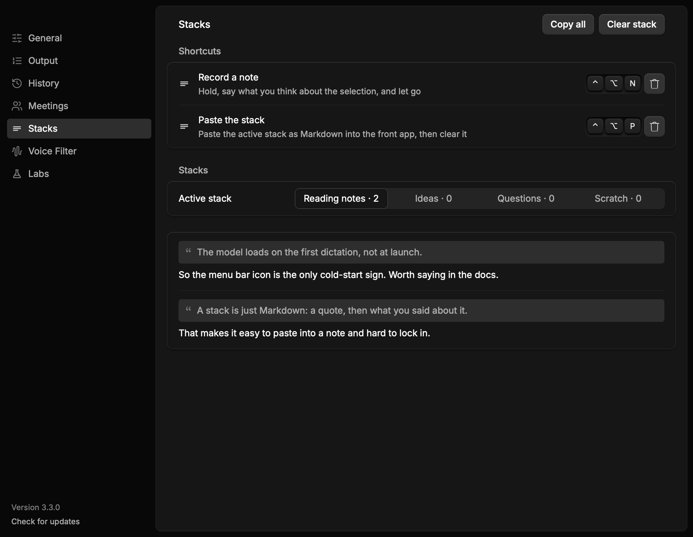

# Stacks: annotations collected from what you read

Sendpoint ([saiashirwad/sendpoint2](https://github.com/saiashirwad/sendpoint2))
is a small macOS app for annotating reading. Select text anywhere, hold a key
and talk (or type), and the quote plus your note joins one of four stacks.
Paste the stack as Markdown and start again. Hex already has every hard part:
the dictation engine, the global shortcut machinery, Accessibility selection
reads, clipboard insertion, and a Rune window. This is how Stacks lands in
Hex as a Labs experiment.

## The shape



```ts
Stacks (Labs, macOS)                       // sketch-stacks
├── Option: Settings › Labs › Stacks       // off by default
├── Sidebar › Stacks                       // below Annotate
│   ├── Shortcuts                          // note + paste, recorded in place
│   ├── Four stacks                        // names and note counts
│   └── Notes                              // quote and body, newest last
├── Control+Option+N (default)
│   ├── read the front app's selection     // Accessibility AXSelectedText
│   ├── hold to dictate                    // the ordinary dictation HUD
│   └── release → append a note            // body-only when nothing is selected
├── Control+Option+P (default)
│   ├── active stack → Markdown            // > quote, blank line, body, ---
│   └── paste into the front app, clear    // the stack empties once queued
└── ~/Library/Application Support/hex/stacks.json
    ├── version, active, stacks[]
    ├── notes stay until Clear stack or Paste; no History retention
    └── owner-only, atomic writes, corrupt file preserved
```

## What maps where

- **Selection** — `accessibility::selected_text(pid)` reads the focused
  element's `AXSelectedText`, bounded to one note's quote. When the app
  exposes no selection, `paste::copy_selection` sends its Copy command,
  waits up to 300 ms for the pasteboard, reads the string, and puts every
  captured flavor back. The shortcut loop reads it at the press, while the
  front app still owns focus, and keeps it with the job
  (`recognition::stack_selection`). The fallback waits up to 300 ms before
  the microphone opens, so an app without an AX selection can lose the first
  moment of speech; the Accessibility path returns in a few milliseconds.
- **Speech** — the note shortcut is another `DictationHotkey` machine
  (`Shortcut::StackNote`), so it inherits hold/toggle, double-tap lock, the
  pre-roll, the release tail, the HUD, cancellation, and queue order. Its
  transcript uses `TranscriptionTarget::StackNote`: the output worker commits
  it without pasting or writing History, and the listener appends it to the
  store.
- **Store** — `src/stacks.rs`. Four named stacks, notes with a quote and a
  body, one small JSON file, read fresh under one process-wide lock on every
  operation so the listener and window cannot disagree. Bounds: 500 notes per
  stack, 8 KiB each for quote and body.
- **Markdown** — `stacks::compose`: a blockquote per quote, its body after,
  `---` between notes. This is exactly what Paste sends and what a future
  Open file and `hex stacks` command can write.
- **Window** — `rune_ui::stacks`, a normal pane under Annotate while the lab
  is on. It records both shortcuts with the same recorder General uses, shows
  the four stacks, and draws the active stack's notes. `mac-stacks` is a
  `--scene` fixture with sample notes.
- **Paste** — `DictationWorker::paste_stack` hands the Markdown to the one
  paster, so clipboard restoration, continuation, and terminal behavior are
  the same as a dictation's. The stack clears when the paste is queued, as
  Sendpoint's does.

## Deliberately left for the next pass

- **The floating note card.** Sendpoint's typed note (⌘G) is a focusable
  overlay. Rune can do it (`OverlayOptions { keys: KeyPolicy::OnDemand }` plus
  `request_keys`), but this branch starts with the spoken flow and the pane.
  The card should appear where the selection is, with the quote above a text
  field, and Enter/⇧Enter/Esc as Sendpoint has them.
- **Windows and Linux selection adapters.** The store, pane, and Markdown are
  cross-platform already; only the selection read and the shortcut bindings
  are macOS. `on_this_os` keeps the lab off where it cannot work.
- **Per-stack switching shortcuts** (Sendpoint's ⌥H/J/K/L) and a **Rename**
  action. The pane switches and the store renames; neither has a key yet.
- **Editing notes in the pane** and the file round-trip Sendpoint has (its
  stack files are Markdown and polled for edits). The JSON store is the
  deliberate first step; a Markdown file per stack can replace it if editing
  outside Hex matters.
- **Goldens.** `mac-labs` gains the Stacks card and `mac-stacks` is a new
  scene; goldens are Linux-only, so `check-linux.yml` must refresh them.
